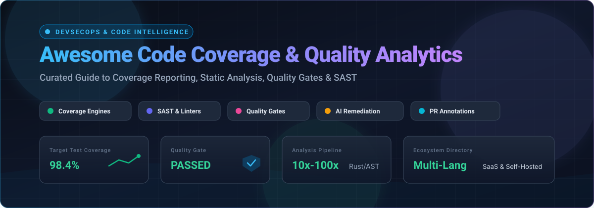

# Awesome-Code-Coverage-Quality-Analytics

  

  
  
  
  
  

  <strong>Curated Directory of Open-Source Tools &amp; SaaS Platforms for Code Coverage, Static Analysis, Quality Gates, SAST &amp; Code Intelligence 🚀</strong>

  <em>Measure test coverage, enforce CI/CD quality gates, detect bugs and security vulnerabilities, eliminate dead code, and maintain healthy software pipelines.</em>

---

## 📑 Table of Contents

- [🌐 Sector Overview & Market Dynamics](#-sector-overview--market-dynamics)
- [☁️ SaaS & Hosted Platforms](#️-saas--hosted-platforms)
- [💻 Open-Source GitHub Projects](#-open-source-github-projects)
  - [Top Open-Source Tools (Ranked by Stars)](#top-open-source-tools-ranked-by-stars)
  - [Specialized Ecosystem Utilities](#specialized-ecosystem-utilities)
  - [Architectural Framework Combinations](#architectural-framework-combinations)
- [🤝 How to Contribute](#-how-to-contribute)
- [⚖️ Disclaimer & Engineering Guidelines](#️-disclaimer--engineering-guidelines)
- [⭐ Star History](#-star-history)
- [💖 Support & Sponsorship](#-support--sponsorship)

---

## 🌐 Sector Overview & Market Dynamics

The global static code analysis and code quality analytics market is valued between **$1.1B and $1.4B**, projected to surpass **$3.5B–$5.5B** over the next decade at a CAGR of 10%–13% (with code coverage utilities tracking parallel expansion above $2B). The sector is **moderately concentrated at the top**—dominated by enterprise application security leaders (Synopsys, SonarSource, Snyk) securing Fortune 500 contracts—while maintaining a **highly fragmented long tail** of developer-centric, niche linters, IDE integrations, and community-driven open-source instrumentation libraries.

---

## ☁️ SaaS & Hosted Platforms

| Product | Company Valuation / Revenue | Starting Pricing | Free Tier / Trial Limits | Description & Best For |
| :--- | :--- | :--- | :--- | :--- |
| **[Coverity](https://www.synopsys.com/software-integrity/security-testing/static-analysis-sast.html)** (Synopsys / Black Duck) | **~$90B Market Cap** (~$6.1B ARR) | Custom enterprise quote (typically starts ~$800–$1,500/developer/year; contract minimums typically $50k+/year) | No standard commercial self-serve free trial (14–30 day custom POC via sales); **Free tier** via [Coverity Scan](https://scan.coverity.com/) strictly for registered open-source projects. | Enterprise-grade static analysis (SAST) with deep defect detection and compliance rules. Best for regulated enterprises needing rigorous SAST. |
| **[Snyk Code](https://snyk.io/product/snyk-code/)** (Snyk) | **~$7.4B Valuation** (Series G) | **$25/contributing developer/month** (Team plan, up to 10 devs) | **Free forever plan**: up to 100 code tests/month across up to 5 projects with IDE & CLI integrations. | Developer-first AI-powered SAST with real-time IDE analysis and PR checks across 18+ languages. Best for security teams wanting integrated SAST and SCA. |
| **[SonarQube Cloud](https://www.sonarsource.com/products/sonarqube/cloud/)** (SonarSource) | **~$4.7B Valuation** | **$34/month** (Team tier, starts at up to 100k lines of code; scales with LOC) | **Free forever plan**: up to 50,000 LOC for private repos (up to 5 users) and unlimited LOC for public/open-source repos. | Managed static analysis & code quality across 40+ languages with automated quality gates. Best for teams wanting SonarQube rules without managing self-hosted infrastructure. |
| **[Qodana](https://www.jetbrains.com/qodana/)** (JetBrains) | **~$700M+ Annual Revenue** | **$5.00/active contributor/month** (Ultimate plan, min. 3 contributors, billed annually) | **Free Community Plan**: unlimited LOC and tests/projects for JVM, Python, .NET, C/C++; 30-day cloud data retention (excludes Go & JS/TS). | JetBrains-native static analysis platform providing IDE-consistent inspections in CI pipelines. Best for teams standardized on JetBrains tools. |
| **[Codecov](https://about.codecov.io/)** (Harness / ex-Sentry) | **~$3B Valuation** (Parent Harness/Sentry; ~$2.9M ARR standalone) | **$5/user/month** (Team tier; Pro at $12/user/month) | **Free Developer Plan**: 1 user, up to 250 private repo coverage uploads/month; unlimited uploads and users for public open-source repos. | Specialized coverage reporting ingesting test coverage matrices, monorepo flags, and PR annotations. Best for teams needing granular PR coverage checks and flaky test insights. |
| **[Codacy](https://www.codacy.com/)** | **~$30M+ Total Funding** (~$7M–$18M ARR) | **$15/user/month** (Pro plan billed annually) | **14-day free trial** with full Pro access; **Free Developer Plan**: free forever for individual IDE AI Guardrails extension; unlimited free for open-source repos. | Comprehensive code quality platform combining static analysis across 49 languages with coverage tracking and secret detection. Best for multi-language teams seeking broad test & security gating. |
| **[DeepSource](https://deepsource.com/)** | **~$10M Total Funding** (~$2M ARR) | **$24/user/month** (Team tier billed annually) | **Free forever plan**: up to 3 team members, 3 private repositories, 3 SCA manifest targets, and unlimited public repos. | Static analysis and Autofix engine boasting <5% false-positive rate with automatic code remediation. Best for teams prioritizing high-signal alerts and automated PR fixes. |
| **[Coveralls](https://coveralls.io/)** | **Bootstrapped / Private** | **$10/month** (Starter tier: 1 private repo, unlimited users; up to $400/month unlimited repos) | **30-day free trial** for private repository tiers; **Free forever plan** for unlimited public/open-source repositories with unlimited users. | Focused coverage history and PR tracking with per-repository pricing. Best for large engineering teams with few repositories seeking unlimited user seats. |

---

## 💻 Open-Source GitHub Projects

### Top Open-Source Tools (Ranked by Stars)

- **[Ruff](https://github.com/astral-sh/ruff)**   
  ⚡ **Extremely fast Python linter and code formatter written in Rust** (MIT) — 10–100× faster than Flake8, Black, and isort combined. Replaces dozen-tool Python linting stacks with a single static analyzer and autofix engine. **Features**: 800+ built-in lint rules reimplementing Flake8 plugins, pyupgrade, autofixes, monorepo support, and native VS Code/language server integration. **Best for**: Any modern Python codebase seeking instant static quality checks and formatting.

- **[golangci-lint](https://github.com/golangci/golangci-lint)**   
  🐹 **Definitive fast linter runner and static analysis platform for Go** (GPL-3.0) — Runs linters in parallel, caches Go build programs, and reuses ASTs for maximum throughput. Integrates dozens of linters (govet, errcheck, staticcheck, unused) in one unified CLI and GitHub Actions workflow. **Best for**: Go developers and CI pipelines requiring fast, comprehensive static checks.

- **[Semgrep](https://github.com/semgrep/semgrep)**   
  🛡️ **Lightweight polyglot static analysis engine and SAST** (LGPL-2.1) — Scans code for bugs, security flaws, and compliance anti-patterns using code-syntax pattern matching (`$X == $X`). Covers 30+ languages without slow compilation steps, making custom rule writing accessible in minutes. **Best for**: AppSec and engineering teams wanting custom quality rules and fast CI static analysis.

- **[Infer](https://github.com/facebook/infer)**   
  🔬 **Static analysis engine for Java, C, C++, and Objective-C** (MIT) — Developed by Meta to mathematically verify memory safety and catch null pointer dereferences, resource leaks, data races, and concurrency bugs before deployment to production apps. **Best for**: Large-scale systems and mobile apps (Android/iOS) requiring deep interprocedural static bug detection.

- **[SonarQube Community Build](https://github.com/SonarSource/sonarqube)**   
  🏛️ **The standard self-hosted automated code review and quality platform** (LGPL-3.0) — Analyzes 40+ programming languages to detect bugs, vulnerabilities, and code smells. Enforces the Clean Code methodology through blocking quality gates and integrates with IDEs via SonarLint Connected Mode. **Best for**: Organizations wanting centralized self-hosted code quality metrics and standard quality gates across heterogeneous stacks.

- **[Checkstyle](https://github.com/checkstyle/checkstyle)**   
  ☕ **Configurable Java coding standard enforcement and static analysis tool** (LGPL-2.1) — Validates adherence to coding conventions like Google Java Style and Sun Code Conventions. Easily integrated into Maven, Gradle, Ant, and all major IDEs. **Best for**: Java teams enforcing unified stylistic, architectural, and design conventions.

- **[NYC (Istanbul)](https://github.com/istanbuljs/nyc)**   
  🌐 **The de facto JavaScript & TypeScript test coverage CLI engine** (ISC) — Built on the Istanbul code instrumentation library. Instruments ES6, TypeScript, Babel, and JSX codebases to measure statement, branch, function, and line coverage across Mocha, Jest, Node-tap, and Ava test suites. **Best for**: JavaScript and TypeScript teams requiring rock-solid coverage reports and LCOV/HTML outputs.

- **[PMD](https://github.com/pmd/pmd)**   
  🔍 **Extensible polyglot static code analyzer and duplicate detector (CPD)** (BSD-style) — Finds common programming flaws like dead code, unused variables, suboptimal string manipulation, and empty catch blocks across Java, JavaScript, Apex, PLSQL, XML, and more. **Best for**: Static defect detection and cross-language copy-paste detection (CPD).

- **[SimpleCov](https://github.com/simplecov-ruby/simplecov)**   
  💎 **The standard code coverage analysis library for Ruby** (MIT) — Hooks directly into Ruby’s built-in Coverage library to provide line, branch, and block coverage with automatic merging across test suites (RSpec, Minitest, Cucumber). Offers formatted HTML reports and group filtering. **Best for**: Ruby and Rails applications requiring straightforward test coverage metrics and CI thresholds.

- **[JaCoCo](https://github.com/jacoco/jacoco)**   
  🧪 **Definitive open-source code coverage library for Java & JVM languages** (EPL-2.0) — Performs on-the-fly bytecode instrumentation using Java agents without requiring source files. Measures instructions (C0), branches (C1), lines, methods, and cyclomatic complexity across Maven, Gradle, and Ant. **Best for**: JVM teams (Java, Kotlin, Scala) seeking standard, performant coverage instrumentation.

- **[SpotBugs](https://github.com/spotbugs/spotbugs)**   
  🐞 **Bytecode static analysis tool for Java** (LGPL-2.1) — The official successor to FindBugs. Employs formal bug pattern matching across compiled Java bytecode to detect over 400 bug patterns including null pointer dereferences, infinite loops, and concurrency risks. **Best for**: Java pipelines catching subtle runtime bugs through bytecode verification.

- **[Coverage.py](https://github.com/coveragepy/coveragepy)**   
  🐍 **The standard code coverage tool for Python** (Apache-2.0) — Monitors Python program execution via trace hooks to measure which statements are executed and identify uncovered branches. Integrates seamlessly with pytest, unittest, and tox. **Best for**: Python test suites requiring accurate branch and statement coverage reports.

- **[Cobertura](https://github.com/cobertura/cobertura)**   
  📊 **Historic Java coverage tool and standardized XML reporting format** (GPL-2.0) — Established the classic Cobertura XML format widely accepted by CI systems (GitLab CI, Jenkins, Azure Pipelines) for test coverage visualization. **Best for**: Legacy JVM builds and systems dependent on Cobertura report schemas.

- **[supercov-cli](https://github.com/supercorp-ai/supercov)**   
  🤖 **Coverage measurement and test target generator for coding agents** (MIT) — Designed for AI-assisted engineering and autonomous software factories. Measures lines, branches, and MC/DC independence witnesses across JS, TS, Rust, Python, Go, and Java, generating actionable test targets for LLMs. **Best for**: AI-driven development workflows and automated test authoring loops.

- **[OpenClover](https://github.com/openclover/clover)**   
  🍀 **Sophisticated code coverage and test optimization platform for Java** (Apache-2.0) — Provides per-test coverage tracking (revealing which specific test hits which line), risk-metric cross tabulations, and test optimization that executes only tests affected by recent code edits. **Best for**: Engineering teams wanting per-test provenance and predictive test execution in CI.

---

### 🔧 Specialized Ecosystem Utilities

- **[codecov-python](https://github.com/codecov/codecov-python)** — Official Python report uploader for Codecov (Apache-2.0).
- **[jacoco-badge-generator](https://github.com/cicirello/jacoco-badge-generator)** — Lightweight GitHub Action for creating JaCoCo test coverage badges and PR status checks without paid infrastructure (MIT).
- **[go-test-coverage](https://github.com/vladopajic/go-test-coverage)** — Compact CLI tool for enforcing test coverage threshold gates in Go CI/CD workflows (MIT).

---

### 🏗️ Architectural Framework Combinations

Create an end-to-end self-hosted quality infrastructure tailored to your stack:
1. **JVM Ecosystem**: Combine **JaCoCo** for bytecode instrumentation with **SonarQube Community Build** for quality gates and **SpotBugs** for defect scanning.
2. **Python Ecosystem**: Pair **Coverage.py** (or pytest-cov) with **Ruff** for sub-second static analysis and linting.
3. **Go Ecosystem**: Combine native `go test -coverprofile` with **golangci-lint** for comprehensive static code intelligence.
4. **JavaScript/TypeScript**: Combine **NYC (Istanbul)** with **Semgrep** or ESLint for static defect checks and PR coverage.
5. **AI Agent Workflows**: Use **supercov-cli** to measure MC/DC coverage and automatically feed failing or uncovered execution paths directly to autonomous coding agents.

---

## 🤝 How to Contribute

Contributions are warmly welcomed! Help keep this code quality reference accurate and up to date:

1. 🍴 Fork the repository.
2. 📝 Add or refine entries in `README.md` (keep descriptions factual, note license, and follow the established format).
3. 🧪 Verify links and verify Stars_Counts/pricing accuracy.
4. 🚀 Submit a pull request with a concise summary of changes.

---

## ⚖️ Disclaimer & Engineering Guidelines

- **Community Curated**: This is a community-driven reference list and does not constitute an explicit endorsement of any commercial platform or library.
- **Coverage vs. Analysis vs. Reporting**:
  - **Coverage Measurement Engines** (*JaCoCo, Coverage.py, SimpleCov, NYC*): Instrument source code or bytecode and produce raw execution matrices.
  - **Static Analysis Engines** (*Ruff, Semgrep, Infer, SpotBugs, PMD*): Detect vulnerabilities, memory leaks, and anti-patterns without executing binaries.
  - **Coverage Reporting Services** (*Codecov, Coveralls*): Ingest coverage reports from measurement engines to visualize line-by-line diffs and annotate pull requests.
  - **Autonomous Agent Coverage** (*supercov-cli*): Produces machine-actionable test targets specifically designed for LLMs to generate missing test cases.
- **Data Protection & Code Privacy**: When evaluating SaaS tools, verify compliance with SOC2, GDPR, and enterprise IP restrictions before connecting internal or proprietary repositories.

---

## ⭐ Star History

---

## 💖 Support & Sponsorship

Thank you for exploring and supporting **Awesome Code Coverage & Quality Analytics**! 🌟

If you found this curated guide helpful, please consider:
- ⭐ **Starring** this repository to help others discover it.
- 🍴 **Forking** and contributing missing tools or updates.
- 📢 **Sharing** with your team, fellow developers, or DevOps community.
- ☕ **Buying a coffee & sponsoring ongoing maintenance**: Support via the [GitHub Sponsors Dashboard](https://github.com/sponsors/ishandutta2007).

---

  Maintained with care by developers for developers building robust, high-integrity software.

